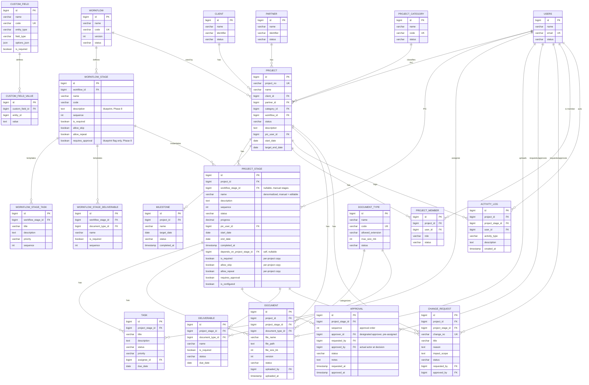

> Implementation notes (`specs/003-project-management-e2e`):
> - `PROJECT` stays merged into `content_detail_projects`; `name` maps to `title`.
> - `CUSTOM_FIELD.options_json` is modeled as `field_type` + JSON-encoded `value` (select/multiselect).
> - `ACTIVITY_LOG` is implemented with the existing spatie `activity_log` table (`log_name = project-management`, `properties.project_id`); no dedicated table.
> - Wizard state is derived per step (no `draft_step` column); see `GET /projects/{project_no}/setup-state`.
