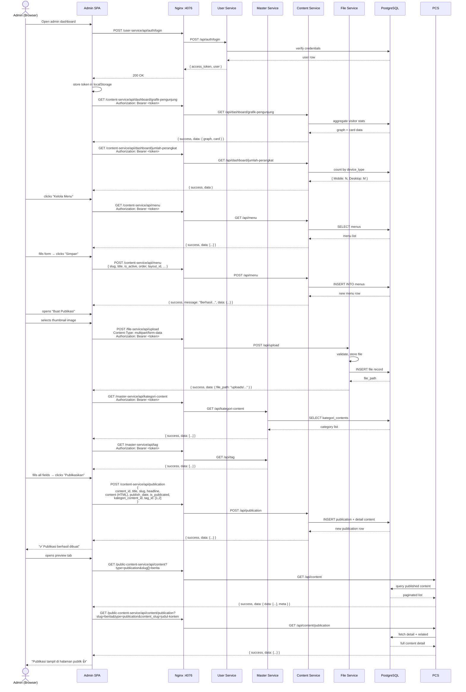
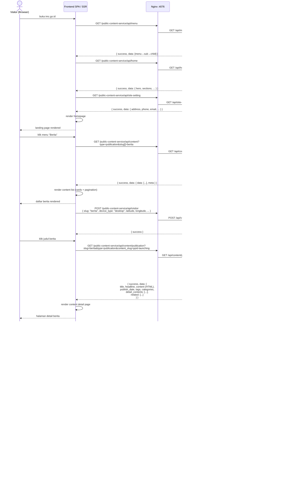
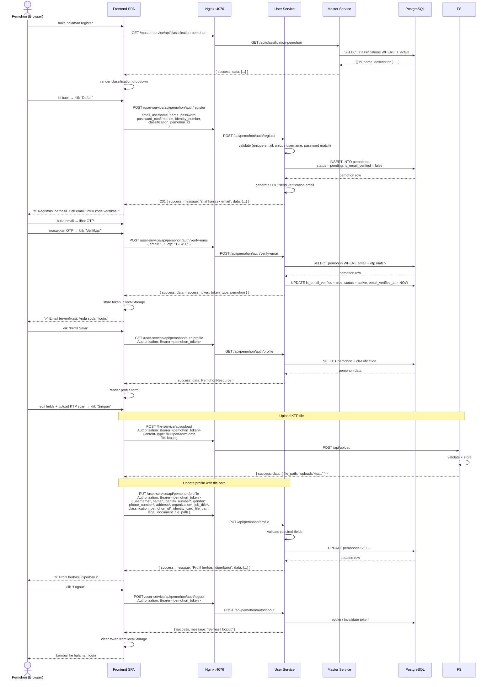
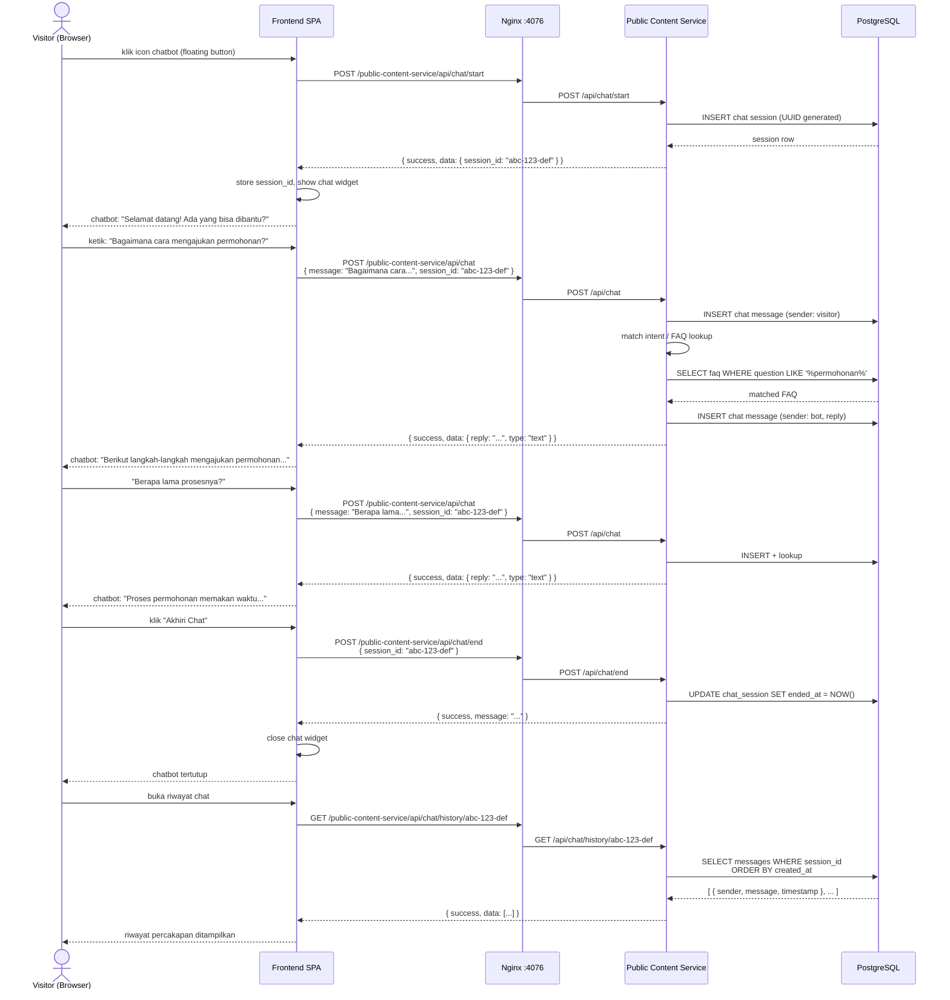
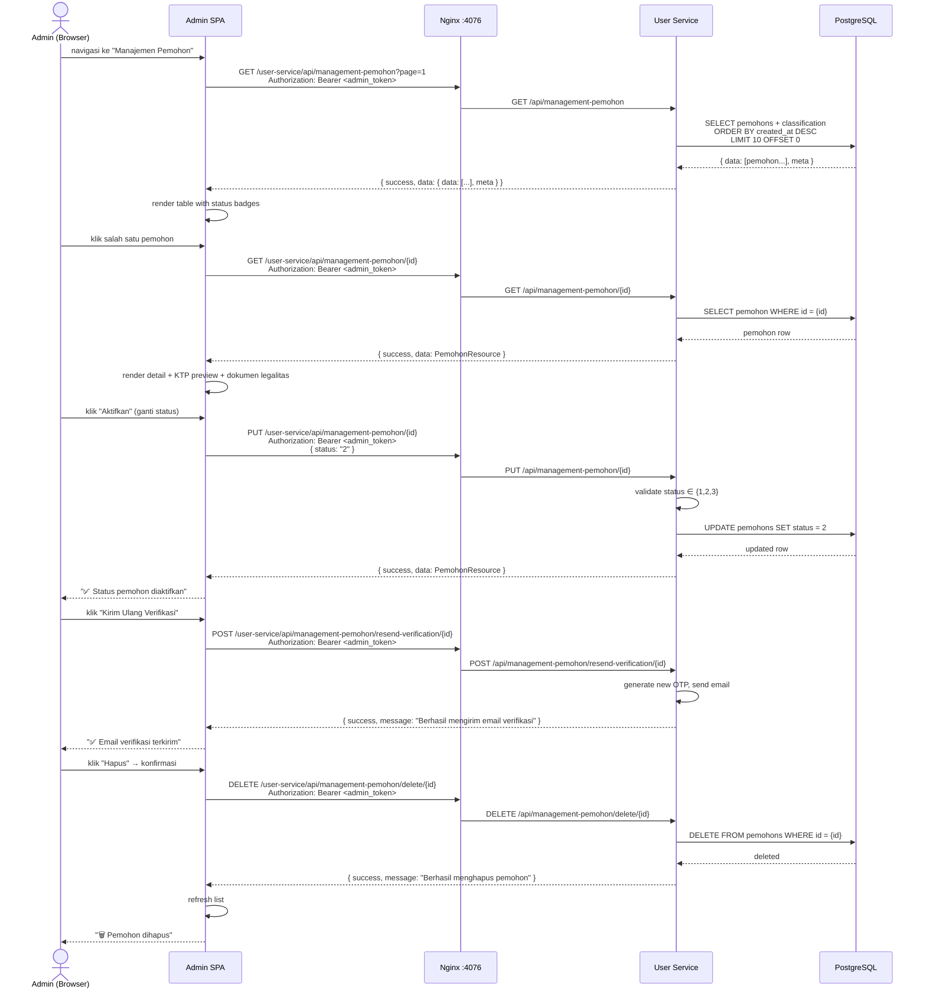
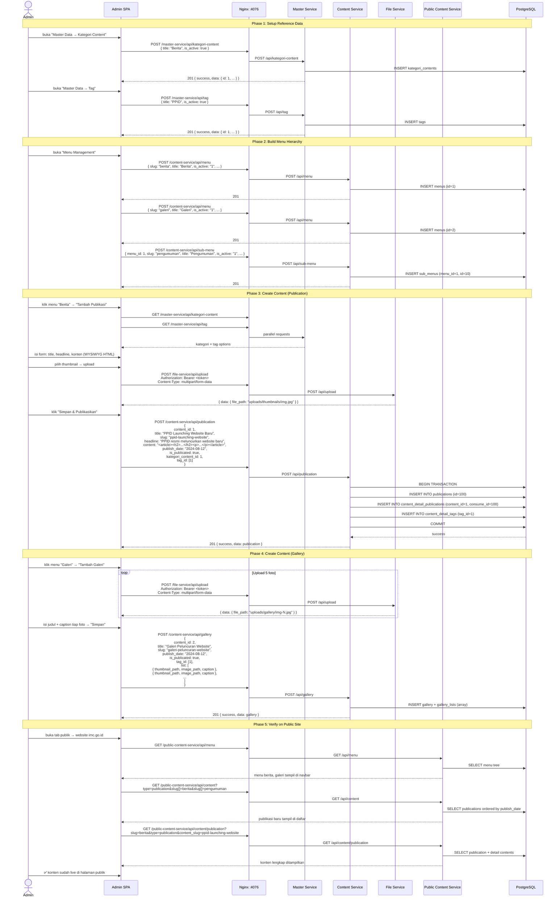

# Front-End API Integration — Quick Start

**Document type:** Design Review Document (DRD)
**Version:** 1.0
**Date:** 2026-08-12
**Audience:** Front-end developers integrating with IMC Backend

---

## Table of Contents

1. [Architecture Overview](#1-architecture-overview)
2. [Sequence Diagrams — Core Flows](#2-sequence-diagrams--core-flows)
3. [Standard Response Envelope](#3-standard-response-envelope)
4. [Authentication](#4-authentication)
5. [Public API — Frontend Pages](#5-public-api--frontend-pages)
6. [Admin API — Dashboard & Content Management](#6-admin-api--dashboard--content-management)
7. [File Service](#7-file-service)
8. [Setting Service](#8-setting-service)
9. [Integration Examples](#9-integration-examples)
10. [Error Reference](#10-error-reference)

---

## 1. Architecture Overview

### Base URL

```
http://localhost:4076        (local dev via Docker)
https://<domain>             (staging / production)
```

Single Nginx reverse proxy routes requests to microservices by **path prefix**.

### Service Mapping

| Path Prefix | Service | Purpose |
|---|---|---|
| `/master-service/` | Master Service | Reference data (negara, faq, satuan-kerja, tag, etc.) |
| `/user-service/` | User Service | Auth (login/register), user/pemohon management |
| `/content-service/` | Content Service | Menu hierarchy, content entities (publication, gallery, etc.) |
| `/public-content-service/` | Public Content | Frontend homepage, menu, content display, chat, visitor tracking |
| `/file-service/` | File Service | Upload, download, serve files, compress/lock |
| `/setting-service/` | Setting Service | Site settings, email templates, chat config |

### Endpoint Pattern

```
{base_url}/{path_prefix}/api/{resource}/{id}
```

Example:
```
http://localhost:4076/user-service/api/auth/login
http://localhost:4076/public-content-service/api/home
http://localhost:4076/file-service/api/upload
```

### Auth Model

Two JWT roles, each with separate login endpoints:

| Role | Login Endpoint | Token Usage |
|---|---|---|
| **Admin** (super_admin, admin_pusat, admin_pustik) | `POST /user-service/api/auth/login` | `Authorization: Bearer <admin_token>` |
| **Pemohon** (public user) | `POST /user-service/api/pemohon/auth/login` | `Authorization: Bearer <pemohon_token>` |

- **Admin** tokens access: all `/master-service/`, `/content-service/`, `/setting-service/`, `/user-service/` management endpoints
- **Pemohon** tokens access: own profile (`/pemohon/profile`, `/pemohon/auth/*`), file upload
- **No token needed**: all `/public-content-service/` endpoints, auth endpoints (login, register), file serve/download

---

## 2. Sequence Diagrams — Core Flows

The system has three main user journeys. Each diagram shows exact API calls, service routing, and data flow.

### 2.1 Admin — Content Creation (End-to-End)



### 2.2 Public — Content Consumption (Menu → List → Detail)



### 2.3 Pemohon — Registration & Auth



### 2.4 Chatbot Interaction



### 2.5 Admin — Pemohon Management



### 2.6 Admin — Full Content Workflow (Menu → Content → Publish → Verify)



### Service Key

| Abbreviation | Service | Base Path |
|---|---|---|
| NGINX | Reverse Proxy (gateway) | `http://localhost:4076` |
| US | User Service | `/user-service/api/` |
| MS | Master Service | `/master-service/api/` |
| CS | Content Service | `/content-service/api/` |
| PCS | Public Content Service | `/public-content-service/api/` |
| FS | File Service | `/file-service/api/` |
| SS | Setting Service | `/setting-service/api/` |

> **Note:** PCS (Public Content Service) is shown only in the last verify-step of the admin workflow. In the consumption diagram it is the primary backend.

---

## 3. Standard Response Envelope

### Success Response

```json
{
  "success": true,
  "message": "Berhasil mengambil data",
  "data": { ... }
}
```

### Paginated List Response

```json
{
  "success": true,
  "message": "Berhasil mengambil data",
  "data": {
    "data": [ ... ],
    "meta": {
      "total": 150,
      "page": 1,
      "limit": 10,
      "total_page": 15
    }
  }
}
```

### Error Response

```json
{
  "success": false,
  "message": "Deskripsi error",
  "errors": {
    "email": ["Email sudah terdaftar."],
    "password": ["Password minimal 8 karakter."]
  },
  "data": null
}
```

### HTTP Status Codes

| Code | Meaning |
|---|---|
| 200 | Success |
| 201 | Created |
| 400 | Bad request |
| 401 | Unauthorized (missing/invalid token) |
| 403 | Forbidden (insufficient role) |
| 404 | Not found |
| 422 | Validation error |
| 500 | Server error |

---

## 4. Authentication

### 4.1 Admin Login

**Endpoint:** `POST /user-service/api/auth/login`

**Request:**
```json
{
  "email_or_username": "admin@imc.go.id",
  "password": "password123"
}
```

**Response (200):**
```json
{
  "access_token": "eyJ0eXAiOiJKV1QiLCJhbGci...",
  "token_type": "bearer",
  "expires_in": "3600",
  "user": {
    "id": 1,
    "email": "admin@imc.go.id",
    "username": "admin_pusat",
    "name": "Admin Pusat",
    "role": "admin_pusat"
  }
}
```

### 4.2 Admin Profile

**Endpoint:** `GET /user-service/api/auth/profile`

**Headers:**
```
Authorization: Bearer <admin_token>
```

**Response (200):**
```json
{
  "success": true,
  "message": "Berhasil mengambil data profil",
  "data": {
    "id": 1,
    "email": "admin@imc.go.id",
    "username": "admin_pusat",
    "name": "Admin Pusat",
    "gender": 1,
    "phone_number": "081234567890",
    "status": "active",
    "role_id": 2,
    "role": "admin_pusat",
    "satuan_kerja_id": 1,
    "sub_satuan_kerja_id": null,
    "perwakilan_id": null,
    "created_by": null,
    "updated_by": null,
    "created_at": "2024-01-01T00:00:00.000000Z",
    "updated_at": "2024-01-01T00:00:00.000000Z"
  }
}
```

### 4.3 Admin Logout

**Endpoint:** `POST /user-service/api/auth/logout`

**Headers:** `Authorization: Bearer <admin_token>`

---

### 4.4 Pemohon Register

**Endpoint:** `POST /user-service/api/pemohon/auth/register`

**Request:**
```json
{
  "email": "user@example.com",
  "username": "johndoe",
  "name": "John Doe",
  "password": "password123",
  "password_confirmation": "password123",
  "identity_number": "3273010101900001",
  "classification_pemohon_id": 1
}
```

**Response (201):**
```json
{
  "success": true,
  "message": "Berhasil registrasi, silakan cek email untuk verifikasi",
  "data": {
    "id": 5,
    "registration_number": "P-20240812-0005",
    "email": "user@example.com",
    "username": "johndoe",
    "name": "John Doe",
    "is_email_verified": false
  }
}
```

### 4.5 Pemohon Login

**Endpoint:** `POST /user-service/api/pemohon/auth/login`

**Request:**
```json
{
  "email_or_username": "johndoe",
  "password": "password123"
}
```

**Response (200):**
```json
{
  "access_token": "eyJ0eXAiOiJKV1QiLCJhbGci...",
  "token_type": "bearer",
  "expires_in": "3600",
  "pemohon": {
    "id": 5,
    "registration_number": "P-20240812-0005",
    "email": "user@example.com",
    "username": "johndoe",
    "name": "John Doe",
    "classification": "Warga Negara",
    "is_email_verified": false
  }
}
```

### 4.6 Email Verification

**Step 1 — Check verification status:**
```
GET /user-service/api/pemohon/auth/verify-email?email=user@example.com
```

**Response (200):**
```json
{
  "success": true,
  "message": "...",
  "data": { "is_email_verified": false }
}
```

**Step 2 — Verify with OTP:**
```
POST /user-service/api/pemohon/auth/verify-email
```

```json
{
  "email": "user@example.com",
  "otp": "123456"
}
```

**Response (200):**
```json
{
  "success": true,
  "message": "Berhasil melakukan verifikasi email",
  "data": {
    "access_token": "eyJ0...",
    "token_type": "bearer",
    "expires_in": "3600",
    "pemohon": { ... }
  }
}
```

### 4.7 Resend OTP

```
GET /user-service/api/pemohon/auth/resend-otp?email=user@example.com
```

### 4.8 Forgot Password

**Request reset link:**
```
POST /user-service/api/pemohon/auth/forgot-password
```

```json
{ "email": "user@example.com" }
```

**Response (200):**
```json
{
  "success": true,
  "message": "Jika email terdaftar, instruksi reset password akan dikirim."
}
```

### 4.9 Reset Password

```
POST /user-service/api/pemohon/auth/reset-password
```

```json
{
  "password": "newpassword123",
  "password_confirmation": "newpassword123",
  "token": "<reset_token_from_email>"
}
```

### 4.10 Pemohon Profile (Authenticated)

**Get profile:**
```
GET /user-service/api/pemohon/auth/profile
```
**Headers:** `Authorization: Bearer <pemohon_token>`

**Update profile:**
```
PUT /user-service/api/pemohon/profile
```
**Headers:** `Authorization: Bearer <pemohon_token>`

```json
{
  "username": "johndoe",
  "name": "John Doe Updated",
  "identity_number": "3273010101900001",
  "gender": "1",
  "phone_number": "081234567890",
  "address": "Jl. Merdeka No. 1, Jakarta",
  "organization": "Universitas Indonesia",
  "job_title": "Mahasiswa",
  "classification_pemohon_id": 1,
  "identity_card_file_path": "uploads/ktp/ktp-john.jpg",
  "legal_document_file_path": null
}
```

### 4.11 Pemohon Logout

```
POST /user-service/api/pemohon/auth/logout
```
**Headers:** `Authorization: Bearer <pemohon_token>`

---

## 5. Public API — Frontend Pages

All endpoints under `/public-content-service/api/`. **No authentication required.**

### 5.1 Homepage

```
GET /public-content-service/api/home
```

Returns all homepage sections. Typical `data` shape includes hero, statistics, latest information, sifat informasi, and section blocks.

### 5.2 Homepage Detail Section

```
GET /public-content-service/api/home/{id}
```

**Response (200):**
```json
{
  "success": true,
  "message": "Berhasil mengambil detail section",
  "data": { /* section data */ }
}
```

**Response (404):** Section not found.

### 5.3 Latest Information (Info Terkini)

```
GET /public-content-service/api/home/latest-information
```

Returns array of latest news/announcement items.

### 5.4 Statistics (Statistik)

```
GET /public-content-service/api/home/statistics
```

Returns aggregated statistics for the homepage counter display.

### 5.5 Sifat Informasi

```
GET /public-content-service/api/home/sifat-informasi
```

Returns list of information classification categories.

### 5.6 Menu (Navigation)

```
GET /public-content-service/api/menu
```

Returns full menu hierarchy (menu → sub-menu → child-sub-menu) for rendering the site navigation.

### 5.7 Public Site Settings

```
GET /public-content-service/api/site-setting
```

Returns site metadata: address, phone, email, social media URLs, max file size.

### 5.8 Quick Links

```
GET /public-content-service/api/quick-link
```

Returns active quick link items.

---

### 5.9 Content Listing

```
GET /public-content-service/api/content
```

**Query Parameters (required):**

| Param | Type | Description |
|---|---|---|
| `type` | string | Content type filter |
| `slug[]` | array[string] | One or more content slugs |

**Example:**
```
GET /public-content-service/api/content?type=publication&slug[]=berita&slug[]=pengumuman
```

**Response (200):**
```json
{
  "success": true,
  "message": "...",
  "data": {
    "data": [ /* content items */ ],
    "meta": { "total": 42, "page": 1, "limit": 10, "total_page": 5 }
  }
}
```

### 5.10 Content Detail

**Publication detail:**
```
GET /public-content-service/api/content/publication?slug=berita&type=publication&content_slug=judul-berita
```

**Repository detail:**
```
GET /public-content-service/api/content/repository?slug=dokumen&type=repository&content_slug=nama-dokumen
```

**Gallery detail:**
```
GET /public-content-service/api/content/gallery?slug=foto&type=gallery&content_slug=nama-galeri
```

Common query params for detail endpoints:

| Param | Type | Required | Description |
|---|---|---|---|
| `slug` | string | Yes | Menu/sub-menu slug |
| `type` | string | Yes | Content type |
| `content_slug` | string | Yes | Specific content item slug |

### 5.11 Global Search

```
GET /public-content-service/api/content/search?q=kata+kunci
```

**Validation:** `q` parameter must not be empty. Returns 422 if empty.

**Response (200):**
```json
{
  "success": true,
  "message": "...",
  "data": { /* search results aggregated across content types */ }
}
```

---

### 5.12 Chatbot

**Step 1 — Start session:**
```
POST /public-content-service/api/chat/start
```
No request body needed.

**Response (200):**
```json
{
  "success": true,
  "message": "...",
  "data": { "session_id": "uuid-string-here" }
}
```

**Step 2 — Send message:**
```
POST /public-content-service/api/chat
```

```json
{
  "message": "Bagaimana cara mengajukan permohonan informasi?",
  "session_id": "uuid-string-here"
}
```

**Response (200):**
```json
{
  "success": true,
  "message": "...",
  "data": { /* bot reply data */ }
}
```

**Step 3 — End session:**
```
POST /public-content-service/api/chat/end
```

**Get chat history:**
```
GET /public-content-service/api/chat/history/{session_uuid}
```

---

### 5.13 Visitor Tracking

```
POST /public-content-service/api/visitor
```

```json
{
  "slug": "berita",
  "latitude": -6.2088,
  "longitude": 106.8456,
  "country": "Indonesia",
  "city": "Jakarta",
  "user_agent": "Mozilla/5.0 ...",
  "device_type": "desktop"
}
```

All fields except `slug` are optional. `device_type` enum: `"desktop"`, `"tablet"`, `"mobile"`, `"unknown"`, or `null`.

---

## 6. Admin API — Dashboard & Content Management

All admin endpoints require: `Authorization: Bearer <admin_token>`

Base paths: `/master-service/api/`, `/content-service/api/`, `/user-service/api/`

### 6.1 User Management (user-service)

#### List Users

```
GET /user-service/api/user
```

**Response:** Paginated list of admin users.

#### Create User

```
POST /user-service/api/user
```

```json
{
  "email": "newadmin@imc.go.id",
  "username": "newadmin",
  "name": "New Admin",
  "password": "securepass123",
  "role_id": 2,
  "satuan_kerja_id": 1
}
```

#### Get / Update / Delete User

```
GET    /user-service/api/user/{id}
PUT    /user-service/api/user/{id}
DELETE /user-service/api/user/{id}
```

#### Pemohon Management

```
GET    /user-service/api/management-pemohon               # list
GET    /user-service/api/management-pemohon/{id}          # detail
PUT    /user-service/api/management-pemohon/{id}          # update status
DELETE /user-service/api/management-pemohon/delete/{id}   # delete
POST   /user-service/api/management-pemohon/resend-verification/{id}
```

**Update status request:**
```json
{ "status": "2" }
```
Status values: `"1"` = pending, `"2"` = active, `"3"` = rejected.

#### Activity & Chat Logs

```
GET /user-service/api/log/activity
GET /user-service/api/log/chat
GET /user-service/api/log/chat/{session_id}
```

#### Bulk Password Import

```
GET  /user-service/api/bulk-password/template           # download template
POST /user-service/api/bulk-password/import             # import (multipart)
```

---

### 6.2 Master Data CRUD (master-service)

All master data entities follow the same REST pattern:

| Operation | Method | Path |
|---|---|---|
| List | `GET` | `/master-service/api/{entity}` |
| Create | `POST` | `/master-service/api/{entity}` |
| Show | `GET` | `/master-service/api/{entity}/{id}` |
| Update | `PUT` | `/master-service/api/{entity}/{id}` |
| Delete | `DELETE` | `/master-service/api/{entity}/{id}` |

#### Available Entities

| Entity | Path | Create Body Fields |
|---|---|---|
| Faq | `/faq` | `title`*, `description`*, `is_active`*, `kategori_faq_id`* |
| Kategori Faq | `/kategori-faq` | `name`* |
| Negara | `/negara` | `name`* |
| Perwakilan | `/perwakilan` | `name`*, `type`*, `negara_id`* (array) |
| Sifat Informasi | `/sifat-informasi` | `name`*, `icon_path`, `description`, `link` |
| Satuan Kerja | `/satuan-kerja` | `name`*, `sub` (array of sub-unit names) |
| Kategori Content | `/kategori-content` | `title`*, `is_active`* |
| Tag | `/tag` | `title`*, `is_active`* |
| Alasan Keberatan | `/alasan-keberatan` | `name`*, `is_active`* |
| Hari Libur | `/hari-libur` | `name`*, `date`* |
| Survey Question | `/survey-question` | `question`*, `type`*, `is_active`*, `order` |

> \* = required

#### Read-Only Entities

```
GET /master-service/api/role                        # roles list
GET /master-service/api/layout                      # layouts list
GET /master-service/api/variable-template-email     # email template variables
GET /master-service/api/classification-pemohon      # pemohon classifications (also public)
```

#### Holiday Import

```
GET  /master-service/api/hari-libur/template-import   # download template
POST /master-service/api/hari-libur/import            # upload (multipart: file)
```

#### Pemohon-Accessible Master Data

Some endpoints also accept `bearerPemohon` tokens:
- `GET /master-service/api/perwakilan`
- `GET /master-service/api/satuan-kerja`
- `GET /master-service/api/alasan-keberatan`
- `GET /master-service/api/list-pertanyaan-survei`

---

### 6.3 Menu Management (content-service)

#### Menu

```
GET|POST       /content-service/api/menu
GET|PUT|DELETE /content-service/api/menu/{id}
```

**Create request:**
```json
{
  "slug": "berita",
  "title": "Berita",
  "has_sub": "0",
  "is_active": "1",
  "is_show_front": true,
  "order": "1",
  "type": "page",
  "layout_id": "1",
  "is_accessible": true,
  "is_show_home": false,
  "is_show_tag": false
}
```

#### Sub-Menu

```
GET|POST       /content-service/api/sub-menu
GET|PUT|DELETE /content-service/api/sub-menu/{id}
```

**Create request:**
```json
{
  "menu_id": 1,
  "slug": "pengumuman",
  "title": "Pengumuman",
  "has_child": "0",
  "is_active": "1",
  "order": "1",
  "layout_id": "1",
  "is_accessible": true,
  "is_show_home": false,
  "is_show_tag": false
}
```

#### Child Sub-Menu

```
GET|POST       /content-service/api/child-sub-menu
GET|PUT|DELETE /content-service/api/child-sub-menu/{id}
```

**Create request:**
```json
{
  "sub_menu_id": 1,
  "slug": "laporan-tahunan",
  "title": "Laporan Tahunan",
  "is_active": "1",
  "order": "1",
  "type": "page",
  "layout_id": "1",
  "is_accessible": true,
  "is_show_home": false,
  "is_show_tag": false
}
```

---

### 6.4 Content Management (content-service)

All content entities (Publication, Gallery, Repository, Agenda) share the same patterns.

#### Side Menu (sidebar listing)

```
GET /content-service/api/{entity}/side-menu
```

Returns list of active menus for the entity's sidebar navigation.

#### Content List (by content ID)

```
GET /content-service/api/{entity}/list/{contentId}
```

Returns all content items for a given content/section.

#### Publication

```
GET    /content-service/api/publication/side-menu
GET    /content-service/api/publication/list/{contentId}
POST   /content-service/api/publication
GET    /content-service/api/publication/{id}
PUT    /content-service/api/publication/{id}
DELETE /content-service/api/publication/{id}
```

**Create request:**
```json
{
  "content_id": 1,
  "title": "Judul Publikasi",
  "slug": "judul-publikasi",
  "headline": "Headline publikasi",
  "content": "<p>Isi konten dalam HTML</p>",
  "publish_date": "2024-08-12",
  "is_publicated": true,
  "kategori_content_id": 1,
  "tag_id": [1, 2, 3]
}
```

#### Gallery

```
GET    /content-service/api/gallery/side-menu
GET    /content-service/api/gallery/list/{contentId}
POST   /content-service/api/gallery
GET    /content-service/api/gallery/{id}
PUT    /content-service/api/gallery/{id}
DELETE /content-service/api/gallery/{id}
```

**Create request:**
```json
{
  "content_id": 1,
  "title": "Galeri Foto Kegiatan",
  "slug": "galeri-foto-kegiatan",
  "publish_date": "2024-08-12",
  "is_publicated": true,
  "tag_id": [1],
  "list": [
    {
      "thumbnail_path": "uploads/gallery/thumb-1.jpg",
      "image_path": "uploads/gallery/img-1.jpg",
      "caption": "Foto kegiatan 1"
    },
    {
      "thumbnail_path": "uploads/gallery/thumb-2.jpg",
      "image_path": "uploads/gallery/img-2.jpg",
      "caption": "Foto kegiatan 2"
    }
  ]
}
```

#### Repository

```
GET    /content-service/api/repository/side-menu
GET    /content-service/api/repository/list/{contentId}
POST   /content-service/api/repository
GET    /content-service/api/repository/{id}
PUT    /content-service/api/repository/{id}
DELETE /content-service/api/repository/{id}
```

**Create request:**
```json
{
  "content_id": 1,
  "title": "Laporan Tahunan 2024",
  "slug": "laporan-tahunan-2024",
  "file_path": "uploads/docs/laporan-2024.pdf",
  "thumbnail_path": "uploads/docs/thumb-laporan.jpg",
  "publish_date": "2024-08-12",
  "is_publicated": true,
  "tag_id": [1, 2]
}
```

#### Agenda

```
GET    /content-service/api/agenda/side-menu
GET    /content-service/api/agenda/list/{contentId}
POST   /content-service/api/agenda
GET    /content-service/api/agenda/{id}
PUT    /content-service/api/agenda/{id}
DELETE /content-service/api/agenda/{id}
```

**Create request:**
```json
{
  "content_id": 1,
  "event_name": "Rapat Koordinasi Tahunan",
  "is_range": true,
  "datetime_start": "2024-08-15 09:00:00",
  "datetime_end": "2024-08-15 17:00:00",
  "is_active": true
}
```

#### Section (Home Page Sections)

```
GET    /content-service/api/section
POST   /content-service/api/section
GET    /content-service/api/section/{id}
PUT    /content-service/api/section/{id}
```

No DELETE for sections.

**Create request:**
```json
{
  "section_title": "Informasi Terkini",
  "is_section": "1",
  "order": "1",
  "type": "latest_information"
}
```

#### Latest Information

```
GET    /content-service/api/latest-information
POST   /content-service/api/latest-information
GET    /content-service/api/latest-information/{id}
PUT    /content-service/api/latest-information/{id}
DELETE /content-service/api/latest-information/{id}
```

**Create request:**
```json
{
  "title": "PPID IMC Launching Website Baru",
  "is_active": true,
  "publish_date": "2024-08-12",
  "url": "https://example.com/berita/ppid-launching"
}
```

#### Quick Links (Admin)

```
GET    /content-service/api/quick-link
POST   /content-service/api/quick-link
GET    /content-service/api/quick-link/{id}
PUT    /content-service/api/quick-link/{id}
DELETE /content-service/api/quick-link/{id}
```

**Create request:**
```json
{
  "title": "e-PPID",
  "is_active": true,
  "url": "https://eppid.imc.go.id"
}
```

#### Dashboard

```
GET /content-service/api/dashboard/grafik-pengunjung
GET /content-service/api/dashboard/jumlah-perangkat
```

Returns visitor analytics for the admin dashboard.

#### Content Index

```
GET /content-service/api/content
```

Returns aggregated paginated content list for admin content browsing.

---

## 7. File Service

Base path: `/file-service/api/`

### 7.1 Upload File

```
POST /file-service/api/upload
```
**Auth:** `bearerAdmin` or `bearerPemohon`
**Content-Type:** `multipart/form-data`

| Field | Type | Required |
|---|---|---|
| `file` | File (binary) | Yes |

**Example (curl):**
```bash
curl -X POST \
  -H "Authorization: Bearer $TOKEN" \
  -F "file=@/path/to/document.pdf" \
  http://localhost:4076/file-service/api/upload
```

**Response (201):**
```json
{
  "success": true,
  "message": "...",
  "data": {
    "file_path": "uploads/documents/document.pdf",
    "file_name": "document.pdf",
    "mime_type": "application/pdf",
    "file_size": 204800
  }
}
```

### 7.2 Show / Serve File

```
GET /file-service/api/show?file=uploads/documents/document.pdf
```
No auth required. Returns binary stream with appropriate `Content-Type`.

### 7.3 Download File

```
GET /file-service/api/download?file=uploads/documents/document.pdf
```
No auth required. Returns binary stream with `Content-Disposition: attachment` header.

### 7.4 Get File as Base64

```
POST /file-service/api/base64
```

```json
{ "file": "uploads/documents/document.pdf" }
```

**Response (200):**
```json
{
  "success": true,
  "message": "...",
  "data": { "base64": "JVBERi0xLjQKJe..." }
}
```

### 7.5 Compress Image

```
POST /file-service/api/compress-image
```
**Auth:** `bearerAdmin` or `bearerPemohon`
**Content-Type:** `multipart/form-data`

| Field | Type | Required |
|---|---|---|
| `file` | File (image) | Yes |

### 7.6 Lock Image

```
POST /file-service/api/lock-image
```
**Auth:** `bearerAdmin` or `bearerPemohon`
**Content-Type:** `multipart/form-data`

| Field | Type | Required |
|---|---|---|
| `file` | File (image, max ~20MB) | Yes |

Watermarks the image and returns the processed file.

### 7.7 Lock PDF

```
POST /file-service/api/lock-pdf
```
**Auth:** `bearerAdmin` or `bearerPemohon`
**Content-Type:** `multipart/form-data`

| Field | Type | Required |
|---|---|---|
| `file` | File (PDF, max ~20MB) | Yes |

Watermarks the PDF and returns the processed file.

---

## 8. Setting Service

Base path: `/setting-service/api/`. All endpoints require `bearerAdmin` auth.

### 8.1 Site Settings

```
GET /setting-service/api/site-setting
PUT /setting-service/api/site-setting
```

**Update request:**
```json
{
  "address": "Jl. Merdeka No. 1, Jakarta Pusat",
  "phone": "021-1234567",
  "wa_number": "081234567890",
  "email": "ppid@imc.go.id",
  "facebook_url": "https://facebook.com/ppidimc",
  "youtube_url": "https://youtube.com/@ppidimc",
  "instagram_url": "https://instagram.com/ppidimc",
  "twitter_url": "https://twitter.com/ppidimc",
  "max_file_size": 20480
}
```

Only `address`, `phone`, `wa_number`, and `email` are required.

### 8.2 Chat Settings

```
GET /setting-service/api/chat-setting
PUT /setting-service/api/chat-setting
```

**Update request:**
```json
{
  "opening": "Selamat datang di layanan chat PPID IMC",
  "closing": "Terima kasih telah menggunakan layanan kami",
  "confirmation": "Apakah jawaban ini membantu?",
  "another_question": "Apakah ada pertanyaan lain?",
  "to_whatsapp": "Lanjutkan ke WhatsApp"
}
```

All fields required.

### 8.3 Email Templates

```
GET /setting-service/api/template-email
GET /setting-service/api/template-email/{id}
PUT /setting-service/api/template-email/{id}
PUT /setting-service/api/template-email/update-all
```

---

## 9. Integration Examples

### 9.1 JavaScript / Axios — Public Homepage

```javascript
import axios from 'axios';

const BASE_URL = 'http://localhost:4076';

// Fetch homepage data
async function getHomepage() {
  const { data } = await axios.get(`${BASE_URL}/public-content-service/api/home`);
  if (!data.success) throw new Error(data.message);
  return data.data;
}

// Fetch menu navigation
async function getMenu() {
  const { data } = await axios.get(`${BASE_URL}/public-content-service/api/menu`);
  return data.data;
}

// Fetch content list
async function getContentList(type, slugs) {
  const params = new URLSearchParams();
  params.set('type', type);
  slugs.forEach(s => params.append('slug[]', s));

  const { data } = await axios.get(
    `${BASE_URL}/public-content-service/api/content?${params}`
  );
  return data.data;
}

// Search
async function search(query) {
  const { data } = await axios.get(
    `${BASE_URL}/public-content-service/api/content/search`,
    { params: { q: query } }
  );
  return data.data;
}
```

### 9.2 JavaScript / Axios — Auth & Protected Requests

```javascript
// Admin login
async function adminLogin(emailOrUsername, password) {
  const { data } = await axios.post(
    `${BASE_URL}/user-service/api/auth/login`,
    { email_or_username: emailOrUsername, password }
  );
  return data; // { access_token, token_type, expires_in, user }
}

// Pemohon register
async function register(form) {
  const { data } = await axios.post(
    `${BASE_URL}/user-service/api/pemohon/auth/register`,
    form
  );
  return data;
}

// Create axios instance with auth interceptor
const api = axios.create({ baseURL: BASE_URL });

api.interceptors.request.use(config => {
  const token = localStorage.getItem('admin_token');
  if (token) {
    config.headers.Authorization = `Bearer ${token}`;
  }
  return config;
});

api.interceptors.response.use(
  response => response,
  error => {
    if (error.response?.status === 401) {
      localStorage.removeItem('admin_token');
      window.location.href = '/login';
    }
    return Promise.reject(error);
  }
);

// Fetch admin user list
async function getUsers(page = 1) {
  const { data } = await api.get(
    `/user-service/api/user?page=${page}`
  );
  return data.data;
}

// Create FAQ
async function createFaq(faq) {
  const { data } = await api.post(
    `/master-service/api/faq`,
    faq
  );
  return data;
}

// Upload file
async function uploadFile(file) {
  const formData = new FormData();
  formData.append('file', file);

  const { data } = await api.post(
    `/file-service/api/upload`,
    formData,
    { headers: { 'Content-Type': 'multipart/form-data' } }
  );
  return data.data.file_path;
}
```

### 9.3 JavaScript / Axios — Chatbot Flow

```javascript
class Chatbot {
  constructor() {
    this.baseUrl = `${BASE_URL}/public-content-service/api`;
    this.sessionId = null;
  }

  async start() {
    const { data } = await axios.post(`${this.baseUrl}/chat/start`);
    this.sessionId = data.data.session_id;
    return data.data;
  }

  async send(message) {
    if (!this.sessionId) throw new Error('Session not started');
    const { data } = await axios.post(`${this.baseUrl}/chat`, {
      message,
      session_id: this.sessionId,
    });
    return data.data;
  }

  async end() {
    const { data } = await axios.post(`${this.baseUrl}/chat/end`);
    this.sessionId = null;
    return data;
  }

  async history(sessionUuid) {
    const { data } = await axios.get(
      `${this.baseUrl}/chat/history/${sessionUuid}`
    );
    return data.data;
  }
}
```

### 9.4 JavaScript / Axios — File Upload with Preview

```javascript
// Upload and get back path to use in content creation
async function handleFileUpload(file) {
  const formData = new FormData();
  formData.append('file', file);

  const { data } = await axios.post(
    `${BASE_URL}/file-service/api/upload`,
    formData,
    { headers: { 'Content-Type': 'multipart/form-data' } }
  );

  const filePath = data.data.file_path;
  const fileUrl = `${BASE_URL}/file-service/api/show?file=${encodeURIComponent(filePath)}`;
  return { filePath, fileUrl };
}
```

### 9.5 cURL — Full Admin Flow

```bash
BASE="http://localhost:4076"

# 1. Login
TOKEN=$(curl -s -X POST "$BASE/user-service/api/auth/login" \
  -H "Content-Type: application/json" \
  -d '{"email_or_username":"admin@imc.go.id","password":"password123"}' \
  | jq -r '.access_token')

# 2. Create a menu
curl -s -X POST "$BASE/content-service/api/menu" \
  -H "Authorization: Bearer $TOKEN" \
  -H "Content-Type: application/json" \
  -d '{
    "slug": "berita",
    "title": "Berita",
    "has_sub": "0",
    "is_active": "1",
    "is_show_front": true,
    "order": "1"
  }'

# 3. Create a tag
curl -s -X POST "$BASE/master-service/api/tag" \
  -H "Authorization: Bearer $TOKEN" \
  -H "Content-Type: application/json" \
  -d '{"title":"PPID","is_active":true}'

# 4. Upload a thumbnail
FILE_PATH=$(curl -s -X POST "$BASE/file-service/api/upload" \
  -H "Authorization: Bearer $TOKEN" \
  -F "file=@thumbnail.jpg" \
  | jq -r '.data.file_path')

# 5. Create a publication
curl -s -X POST "$BASE/content-service/api/publication" \
  -H "Authorization: Bearer $TOKEN" \
  -H "Content-Type: application/json" \
  -d "{
    \"content_id\": 1,
    \"title\": \"PPID Launching Website\",
    \"slug\": \"ppid-launching-website\",
    \"headline\": \"Website baru PPID resmi diluncurkan\",
    \"content\": \"<p>Isi berita...</p>\",
    \"publish_date\": \"2024-08-12\",
    \"is_publicated\": true,
    \"kategori_content_id\": 1,
    \"tag_id\": [1]
  }"

# 6. Verify on public endpoint
curl -s "$BASE/public-content-service/api/content/publication?slug=berita&type=publication&content_slug=ppid-launching-website" | jq .
```

---

## 10. Error Reference

### Common Validation Error Patterns

**422 — Unique constraint:**
```json
{
  "success": false,
  "message": "Data tidak valid.",
  "errors": {
    "email": ["Email sudah terdaftar."],
    "username": ["Username sudah digunakan."]
  }
}
```

**422 — Required field missing:**
```json
{
  "success": false,
  "message": "Data tidak valid.",
  "errors": {
    "title": ["Title wajib diisi."],
    "password": ["Password wajib diisi."]
  }
}
```

**404 — Resource not found:**
```json
{
  "success": false,
  "message": "Data tidak ditemukan.",
  "errors": null,
  "data": null
}
```

**403 — Authorization:**
```json
{
  "message": "Anda tidak memiliki akses."
}
```
Note: 403 responses use a flat `{ message }` structure (no `success` wrapper).

**401 — Unauthenticated:**
```json
{
  "message": "Unauthenticated."
}
```

### Frontend Error Handling Pattern

```javascript
async function apiCall(url, options = {}) {
  try {
    const response = await fetch(`${BASE_URL}${url}`, {
      headers: {
        'Content-Type': 'application/json',
        ...options.headers,
      },
      ...options,
    });

    const body = await response.json();

    if (!response.ok) {
      // Map validation errors to field-level messages
      const fieldErrors = body.errors || {};
      const message = body.message || 'Terjadi kesalahan';
      throw new ApiError(response.status, message, fieldErrors);
    }

    return body;
  } catch (error) {
    if (error instanceof ApiError) throw error;
    throw new ApiError(0, 'Gagal terhubung ke server', {});
  }
}

class ApiError extends Error {
  constructor(status, message, errors) {
    super(message);
    this.status = status;
    this.errors = errors;
  }
}
```

---

## Appendix A: Token Expiry & Refresh

- JWT tokens are returned with `expires_in` (seconds until expiry).
- No refresh token endpoint currently — re-login when token expires.
- Frontend should store token in `localStorage` or `sessionStorage` and check expiry before API calls.

## Appendix B: API Documentation (OpenAPI / Swagger)

Generated OpenAPI specs available at:
```
http://localhost:4076/docs-service/
```

Interactive Scalar UI for each service allows testing endpoints directly.
