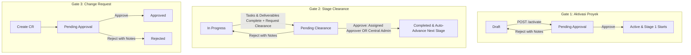

# 006 — Unified Approval System & Approval Inbox

**Status**: Draft (Ready for Review)  
**Author**: Engineering Team  
**Date**: 2026-10-12  
**Related Specs**:
- [004-project-approval-and-stage-completion](../004-project-approval-and-stage-completion/spec.md)
- [005-project-approval-rework](../005-project-approval-rework/spec.md)

---

## 1. Problem & Context

Pada revisi sebelumnya ([Spec 005](../005-project-approval-rework/spec.md)), sistem approval disederhanakan dengan menghapus tabel `pm_approvals` dan hanya menyisakan role-based middleware (`super_admin` & `admin_pusat`). Namun, simplifikasi ini menimbulkan beberapa gap kritis terhadap kebutuhan produk dan antarmuka (**Approval Proyek** pada `Home / My Account / Approval`):

1. **Ketiadaan Inbox Approval Terpusat**:
   - UI membutuhkan halaman tunggal yang menampilkan seluruh approval yang menunggu tindakan (pending) lintas proyek (*cross-project*).
   - Pada Spec 005, semua endpoint tersebar dan terkunci per-proyek tanpa endpoint agregat global.
2. **Ketiadaan Siklus Request pada Stage Clearance (Exit Gate)**:
   - Pada Spec 005, stage clearance hanya berupa role-check saat memanggil `complete`.
   - Tim lapangan tidak memiliki tombol/aksi untuk "mengajukan clearance" (*request clearance*).
   - Stage tetap berstatus `in_progress` (tidak ada status `pending_clearance`), sehingga tidak bisa di-filter di inbox.
   - Tidak ada endpoint penolakan (*reject*) maupun pencatatan alasan revisi (*rejection notes*) jika clearance ditolak.
3. **Kebutuhan Multi-Approver & Dual Authorization pada Stage**:
   - Bisnis membutuhkan penugasan approver spesifik per stage saat wizard konfigurasi proyek.
   - Arsitektur harus siap menampung banyak approver (*multi-approver ready*), dengan aturan keputusan **cukup salah satu menyetujui (*first-come / any-one*)**.
   - Admin Pusat / Super Admin tetap memiliki kewenangan untuk membantu mengesahkan (*override / bypass*).
4. **Pencatatan Metadata Pengajuan**:
   - Kolom UI membutuhkan: `Nama Proyek`, `Jenis Request`, `Nama Pengajuan` (requester), `Tanggal` (requested_at), dan `Detail Proyek` (ringkasan/notes).
   - Aktivasi proyek dan stage clearance sebelumnya tidak menyimpan `requested_by` dan `requested_at`.

---

## 2. Model 3 Jenis Approval

Sistem approval menaungi 3 jenis request persetujuan:

| # | Jenis Request | Trigger / Pengaju | Siapa yang Menyetujui | Mekanisme Keputusan | Efek pada Approval | Efek pada Entitas |
|---|---|---|---|---|---|---|
| **1** | **Aktivasi Proyek** | Admin submit aktivasi draft proyek (`POST /projects/{id}/activate`) | Fixed role: `super_admin`, `admin_pusat` | Role-based decision | Row approval: `approved` | Status proyek: `draft → active`, stage 1 mulai (`in_progress`) |
| **2** | **Stage Clearance** | PIC/Admin request clearance setelah task/deliverable wajib selesai (`POST /projects/{id}/stages/{sid}/request-clearance`) | Approver yang ditugaskan di stage **ATAU** `super_admin` / `admin_pusat` (*override*) | **Any-one (first-come)**: Cukup salah satu menyetujui | Row approval: `approved` | Stage: `pending_clearance → completed`, auto-advance ke stage berikutnya |
| **3** | **Change Request (CR)** | Admin mencatat usulan perubahan (`POST /projects/{id}/change-requests`) | Fixed role: `super_admin`, `admin_pusat` | Role-based decision | Row approval: `approved` | CR: `pending_approval → approved`. *(Catatan: eksekusi apply diff ke proyek di luar cakupan saat ini)* |

---

## 3. Desain Data Model

### A. Tabel Baru: `pm_approval_requests` (Unified Inbox Read/Write Model)
Tabel terpadu untuk agregasi seluruh transaksi persetujuan lintas proyek.

```sql
CREATE TABLE pm_approval_requests (
    id BIGINT UNSIGNED AUTO_INCREMENT PRIMARY KEY,
    project_id BIGINT UNSIGNED NOT NULL,
    approvable_type VARCHAR(50) NOT NULL, -- 'project_activation', 'stage_clearance', 'change_request'
    approvable_id BIGINT UNSIGNED NOT NULL,
    type VARCHAR(50) NOT NULL, -- 'activation', 'stage_clearance', 'change_request'
    title VARCHAR(255) NOT NULL, -- Nama proyek atau judul pengajuan
    description TEXT NULL, -- Ringkasan detail perubahan / catatan pengajuan
    status VARCHAR(20) NOT NULL DEFAULT 'pending', -- 'pending', 'approved', 'rejected'
    requested_by BIGINT UNSIGNED NULL, -- FK users
    requested_at TIMESTAMP NULL,
    approved_by BIGINT UNSIGNED NULL, -- FK users (eksekutor approve/reject)
    approved_at TIMESTAMP NULL,
    rejection_notes TEXT NULL,
    created_at TIMESTAMP NULL,
    updated_at TIMESTAMP NULL,
    deleted_at TIMESTAMP NULL,
    FOREIGN KEY (project_id) REFERENCES content_detail_projects(id) ON DELETE CASCADE,
    FOREIGN KEY (requested_by) REFERENCES users(id) ON DELETE SET NULL,
    FOREIGN KEY (approved_by) REFERENCES users(id) ON DELETE SET NULL,
    INDEX idx_approvals_status_type (status, type),
    INDEX idx_approvals_approvable (approvable_type, approvable_id)
);
```

### B. Tabel Baru: `pm_stage_approvers` (Multi-Approver Assignment)
Menampung penugasan approver pada setiap stage.

```sql
CREATE TABLE pm_stage_approvers (
    id BIGINT UNSIGNED AUTO_INCREMENT PRIMARY KEY,
    project_stage_id BIGINT UNSIGNED NOT NULL,
    user_id BIGINT UNSIGNED NOT NULL,
    created_at TIMESTAMP NULL,
    updated_at TIMESTAMP NULL,
    FOREIGN KEY (project_stage_id) REFERENCES pm_project_stages(id) ON DELETE CASCADE,
    FOREIGN KEY (user_id) REFERENCES users(id) ON DELETE CASCADE,
    UNIQUE KEY uq_stage_user (project_stage_id, user_id)
);
```

### C. Penyesuaian Kolom pada Tabel Eksisting

#### `content_detail_projects`
- Tambah `activation_requested_by` (nullable FK users)
- Tambah `activation_requested_at` (timestamp, nullable)
- Tambah `rejection_notes` (text, nullable)

#### `pm_project_stages`
- Enum `status`: Tambahkan status `pending_clearance` (Alur: `pending → in_progress → pending_clearance → completed | skipped`).
- Tambah `clearance_requested_by` (nullable FK users)
- Tambah `clearance_requested_at` (timestamp, nullable)
- Tambah `rejection_notes` (text, nullable)

#### `pm_change_requests`
- Kolom sudah lengkap di Spec 005 (`status`, `requested_by`, `approved_by`, `notes`, dll).

---

## 4. State Machine & Transisi Siklus Hidup



---

## 5. Spesifikasi Kontrak API

### A. Global Inbox Approval (`/approvals`)

#### 1. List Approval Inbox
- **Method & Path**: `GET /approvals`
- **Auth**: Admin JWT (`super_admin`, `admin_pusat`, `admin_pustik` atau User dengan hak approver)
- **Query Params**:
  - `status`: `pending` (default), `approved`, `rejected`
  - `type`: `activation`, `stage_clearance`, `change_request`
  - `search`: cari berdasarkan nama proyek atau judul pengajuan
  - `per_page`: integer (default: 10)
  - `page`: integer
- **Logika Otorisasi Filter Data**:
  - Jika caller memiliki role `super_admin` atau `admin_pusat`: melihat seluruh approval sesuai query.
  - Jika caller bukan admin pusat (misal PIC atau worker yang ditugaskan): hanya melihat data `stage_clearance` di mana `caller.id` terdaftar di `pm_stage_approvers` pada stage bersangkutan.
- **Response Format (200 OK)**:
```json
{
  "status": "success",
  "message": "Berhasil mengambil daftar approval",
  "data": [
    {
      "id": 101,
      "project_id": 12,
      "project_name": "Development Modul A",
      "request_type": "change_request",
      "request_type_label": "Change Request (CR)",
      "requester_name": "Maya Redifa",
      "requested_at": "2026-03-12T08:30:00Z",
      "formatted_date": "12 Maret 2026",
      "detail": "Penambahan fitur modul kontrol kelistrikan alternatif guna mengantisipasi keterlambatan...",
      "status": "pending",
      "can_approve": true
    },
    {
      "id": 102,
      "project_id": 14,
      "project_name": "Prototype EV Motor",
      "request_type": "stage_clearance",
      "request_type_label": "Stage Clearance",
      "requester_name": "Maya Redifa",
      "requested_at": "2026-03-12T09:15:00Z",
      "formatted_date": "12 Maret 2026",
      "detail": "Persetujuan tahap pengembangan setelah review desain dan dokumen teknis.",
      "status": "pending",
      "can_approve": true
    }
  ],
  "meta": {
    "current_page": 1,
    "from": 1,
    "last_page": 5,
    "per_page": 10,
    "to": 10,
    "total": 50
  }
}
```

#### 2. Direct Approve dari Inbox Table
- **Method & Path**: `POST /approvals/{id}/approve`
- **Auth**: Admin JWT (Otorisasi: approver terdaftar di stage atau `super_admin`/`admin_pusat`)
- **Side Effect**:
  - `activation`: Proyek menjadi `active`, stage 1 menjadi `in_progress`.
  - `stage_clearance`: Stage menjadi `completed`, `approved_by` tercatat, auto-advance ke stage berikutnya.
  - `change_request`: Status CR menjadi `approved`.
  - Row `pm_approval_requests` diupdate: `status = 'approved'`, `approved_by = caller.id`, `approved_at = now()`.
- **Response**: 200 OK.

#### 3. Direct Reject dari Inbox Table
- **Method & Path**: `POST /approvals/{id}/reject`
- **Auth**: Admin JWT (Otorisasi sama dengan approve)
- **Body**:
```json
{
  "notes": "Dokumen uji ketahanan belum ditandatangani oleh QA lead."
}
```
- **Side Effect**:
  - `activation`: Proyek kembali ke `draft`, `rejection_notes` tersimpan.
  - `stage_clearance`: Stage kembali ke `in_progress`, `rejection_notes` tersimpan.
  - `change_request`: CR menjadi `rejected`, `notes` tersimpan.
  - Row `pm_approval_requests` diupdate: `status = 'rejected'`, `rejection_notes = notes`, `approved_by = caller.id`.
- **Response**: 200 OK.

---

### B. Stage Clearance Lifecycle Endpoints

#### 1. Request Stage Clearance
- **Method & Path**: `POST /projects/{project_id}/stages/{stage_id}/request-clearance`
- **Auth**: Admin / Project Member
- **Body**:
```json
{
  "notes": "Pengerjaan task dan deliverable telah tuntas, mohon approval clearance."
}
```
- **Validasi Prasyarat**:
  - Stage harus dalam status `in_progress`.
  - Seluruh task wajib harus `done` / `cancelled`.
  - Seluruh deliverable dengan `is_required = true` harus `completed`.
  - Stage harus memiliki `requires_approval = true`. (Jika `false`, stage diselesaikan langsung via `POST .../complete`).
- **Side Effect**:
  - Stage `status = 'pending_clearance'`, `clearance_requested_by = caller.id`, `clearance_requested_at = now()`.
  - Membuat entri di `pm_approval_requests`.
- **Response**: 200 OK dengan resource stage terbaru.

#### 2. Konfigurasi Approvers pada Stage Wizard
- **Method & Path**: `PUT /projects/{project_id}/stages/configuration`
- **Payload Body Ekstensi**:
```json
{
  "stages": [
    {
      "id": 10,
      "requires_approval": true,
      "approver_user_ids": [5, 12]
    }
  ]
}
```
- **Side Effect**:
  - Mengupdate flag `requires_approval` pada stage.
  - Menyinkronkan daftar `approver_user_ids` ke tabel `pm_stage_approvers`.

---

## 6. Batasan Ruang Lingkup (Out of Scope)
- **Eksekusi Apply Change Request**: Menuliskan diff proposed changes langsung ke tabel proyek di luar cakupan rilis ini dan akan dibuatkan fitur tersendiri.
- **Client Portal Self-Login**: Client saat ini masih direpresentasikan melalui data master client; login terpisah client portal dikerjakan pada epic mendatang.
